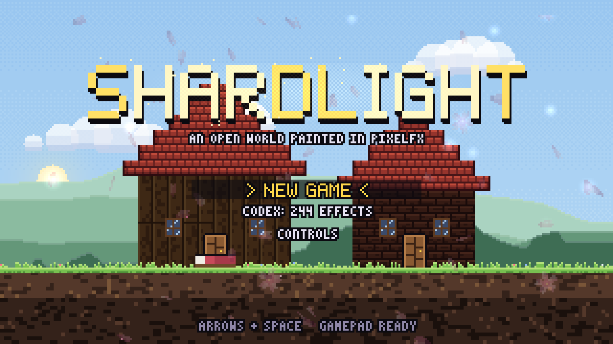
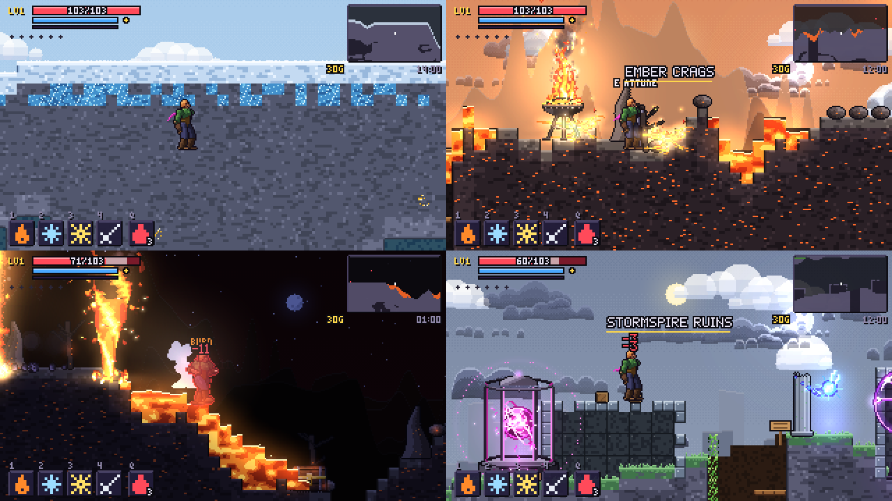
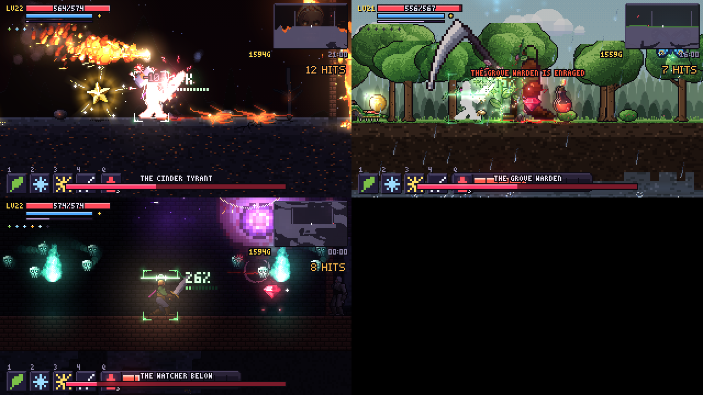

# Shardlight

**A side-scrolling open-world action RPG where every spark, slash, spell, storm and creature is drawn in code with
[pixelfx](https://github.com/patch-gg/pixelfx).** All 244 of the library's effects are in the game, doing a job: swords
swing with their acts, spells are its fire and ice and shadow, slimes and bats are its critters, the sky is its weather,
the wipes between places are its transitions, the shop's potions are its pickups.

<p align="center"></p>

The Lantern on the Stormspire kept the night at bay for a thousand years, until the Hollow King broke it. Six Wardens
carry its shards. Walk out of Brightwater into six lands, take the shards back one by one (in any order), and climb
to the summit.

```bash
npm start            # http://localhost:8080 - plays straight from the source, no build step
npm run build        # dist/index.html + game.js, and dist/shardlight.html (one file)
```

No assets: there are no images or sounds in this repository. The world, the trees, the people, the music and every
effect are generated when the game runs.

## The game

- **An open world**, 1200 x 200 tiles (9600 x 1600 px), seamless: Frostpeak, the Whispering Woods, Verdant Vale, the
  Sunken Marsh, the Ember Crags and the Stormspire Ruins on the surface; the Hollow Crypt, Glimmer Caverns, the
  Sunken Temple, the Magma Veins, the Rime Hollows and the Deep Dark below; the Skyreach Isles above. Generated from a
  seed, the same every time.
- **A hero who acts.** The body is pixelfx's 3D skeleton (`src/core/rig.js`), dressed in a costume painted per body
  part, with a trailing scarf. Weapons combo through the library's melee effects, and the body plays each effect's own
  `act`: the wind-up, the freeze on contact, the follow-through. Thirteen weapon classes: sword, greatsword, daggers,
  spear, hammer, scythe, gauntlets, whip, bow, pistol, scattergun, repeater, launcher.
- **~90 skills in ten schools** (blade, fire, ice, storm, arcane, holy, shadow, nature, tide, tech), every one a pixelfx
  effect: the twelve whole *moves* (Threefold Edge, Phantom Rush, Meteor Call...), novas, breaths, beams, pillars,
  summons, curses, time stop, a hologram decoy, a brute that heaves up out of the floor to fight for you.
- **Thirty-odd kinds of foe**: critter loops (slimes in seven colours that only move while airborne, bats, wisps, shades,
  burning skulls, jellyfish, watcher eyes, core drones) and armed humanoids on the same skeleton as the hero (bandits,
  archers, knights, brutes, skeletons, cultists, gunners, troopers). Twenty-one status effects that wear the body:
  burning, frozen, poisoned, shocked, cursed, asleep, stunned, charmed, petrified, glitched...
- **Seven bosses**: giants on the skeleton drawn twice the size (their slashes blown up to match), a slime king and a
  watching eye three times the size, each with a move set built from one school of effects. The Hollow King rises once.
- **An RPG**: levels and four attributes, gear in five rarities with random affixes and elements (a Frost sword slashes
  in ice colours), armour dyes that change the hero's clothes, potions and elixirs, a smith, an alchemist and a seer,
  thirteen quests, waystones to fast-travel by, a day and night, weather, meteor showers, a festival with fireworks.
- **A codex** in the pause menu that plays every one of the 244 effects live, acted out where it has an act, and says
  where in the game it appears.

<p align="center"></p>
<p align="center"></p>

## Controls

| | keyboard | gamepad |
|---|---|---|
| move | A / D or arrows | stick or d-pad |
| jump (double jump, hover later) | Space, K or Z | A |
| attack (hold with the repeater) | J or X | X |
| dash (hold up: blink, later) | Shift, L or C | B |
| skills | 1 2 3 4 (or U I O P) | bumpers and triggers |
| use, talk, open, read | E or Up | Y |
| potion | Q | left stick press |
| bag / map / menu | Tab / M / Esc | right stick / back / start |

On a phone or tablet, buttons appear on screen. Drop through planks with down and jump.

## How it's built

```
src/
  pfx.js            the bridge: everything taken from pixelfx comes through here
  main.js           the browser: a whole-pixel scaled canvas, a fixed 60 Hz step
  engine/
    render.js       four colour layers sharing one light buffer: lit world and actors, emissive effects, bloom
    fxman.js        effects in the world: pure loops memoized frame by frame, simulations live at 120 Hz,
                    giants' effects drawn at 1x and blown up, culling, following, fading
    input.js        keyboard, gamepad, touch
    audio.js        every sound and the music, synthesized with WebAudio
  world/            the generator, tiles and their art, the sky and far hills, trees and houses, water and lava
  game/             the hero, enemies, bosses, combat, skills, status effects, the RPG, quests, people, the director
  ui/               the HUD, dialogue, shops, the pause menu, the map, the codex, the title
  data/             items, weapons, skills, enemies, and when each effect lands
vendor/pixelfx/     the library, vendored (see its VENDORED.md)
tools/              serve, build, a headless playtest, screenshots, effect coverage
```

The renderer works at the library's own scale: a 320 x 180 frame, the same `{ w, h, ox, oy, color, light }` shape as a
pixelfx frame, so every effect draws straight into the world at world coordinates. The world and the characters are
lit by the hour, the land and the depth, and by the light every effect pours into the shared light buffer: a torch
lights the wall it hangs on, a fireball lights the cave it crosses. Bright effect pixels stay bright in the dark; smoke
takes the scene's light.

Pure loops (torches, waterfalls, slimes, auras) are functions of time, so each frame of each one is drawn once,
cropped, kept and blitted after that. That's what lets the land fill with them: the village alone runs a fountain, a
campfire, braziers, torches, candles, a waystone circle and a seer's orb.

## Checks

```bash
npm test             # a headless playtest: every weapon, skill, foe, status, warden, menu, shop, transition, weather
npm run coverage     # every pixelfx effect is used somewhere, and where (fails if one isn't)
node tools/shot.mjs  # screenshots from a headless run, into shots/
node tools/browser.mjs   # the real game in headless Chromium, with frame times
```

The game holds 60 frames a second in Chromium; a frame takes 3 to 11 ms to render, depending on the weather.

## Credits

- **[pixelfx](https://github.com/patch-gg/pixelfx)** by [Patch](https://patch.gg), MIT: every effect, the skeleton, the
  acts, the fonts used in the HUD.
- pixelfx adapts **[Sprite Fusion's pixel art VFX](https://www.spritefusion.com/pixel-art-vfx)** by Hugo Duprez (MIT)
  and **[Hollow Crown](https://github.com/rehan-remade/hollow-crown)**'s acting (MIT). See `vendor/pixelfx/NOTICE.md`.
- The game is MIT too. Patch's own font is not included.

Built a browser game with pixelfx? Patch can publish it: see [Patch's quickstart](https://docs.patch.gg/quickstart).
